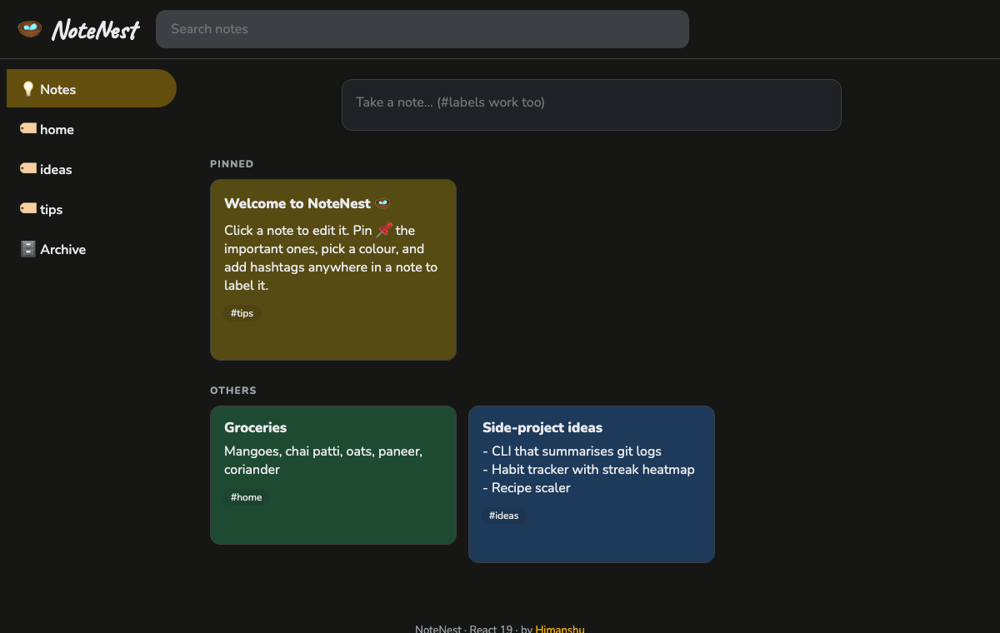

# 🪺 NoteNest

> A fast, Google Keep-style notes app built with **React 19**. It has an expanding composer, colours, pinning, archiving, #hashtag labels, live search, a masonry layout, an edit dialog and **undo delete**. Notes are saved locally.

**🔗 Live demo:** https://himanshuuem.github.io/notenest/

[](https://github.com/himanshuuem/notenest/actions/workflows/deploy.yml)




## ✨ Features

- **Expanding composer:** the classic Keeper interaction. It's one line until you click, then shows a title, body and colour picker. Clicking outside or pressing <kbd>Esc</kbd> saves, and <kbd>Ctrl/⌘</kbd>+<kbd>Enter</kbd> adds the note.
- **Labels from hashtags:** write `#work` anywhere in a note and it becomes a label in the sidebar. Click one to filter. Labels are parsed with a Unicode-aware regex, so `#काम` works too.
- **Pin and archive:** pinned notes get their own section, and archiving unpins.
- **Live search** across titles and bodies.
- **Seven note colours**, each with tuned light and dark variants.
- **Edit in a native `<dialog>`.** It saves on close and only dispatches an update if something actually changed.
- **Undo delete:** a snackbar lets you restore the note **at its original position**.
- **Masonry layout** using CSS `columns` with `break-inside: avoid`, so there's no layout library.

## 🧠 Architecture

```
App (useReducer + localStorage sync)
├── CreateArea     – expanding form, outside-click detection
├── Note ×n        – presentational; actions via callbacks
├── EditDialog     – native <dialog>, diff-before-save
└── ColorPicker    – role="radiogroup"
state/notes.js     – pure reducer + selectors (selectNotes, extractLabels)
```

All state changes go through a pure `notesReducer` (`create`, `update`, `togglePin`, `toggleArchive`, `delete`, `restore`). The derived views (pinned or others, archive, label and search) come from a memoised selector.

## 🧪 Tests

There are 8 Vitest and Testing Library tests: the label parser, the selectors, the reducer (including restore-in-place), the composer flow, delete and undo, search plus label filtering, and persistence. CI runs the tests, builds and deploys to GitHub Pages.

## 🚀 Run Locally

```bash
git clone https://github.com/himanshuuem/notenest.git
cd notenest
npm install
npm run dev
npm test
```

## 📚 Origin

This is my build of **Capstone 5: Keeper App** from the React section of [The Complete Web Development Bootcamp](https://www.udemy.com/course/the-complete-web-development-bootcamp/). It extends the course app with a reducer, labels, pin and archive, search, undo, persistence and tests.

---

Made by [Himanshu](https://github.com/himanshuuem)
